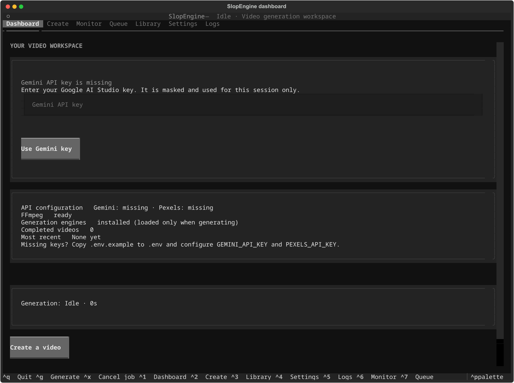
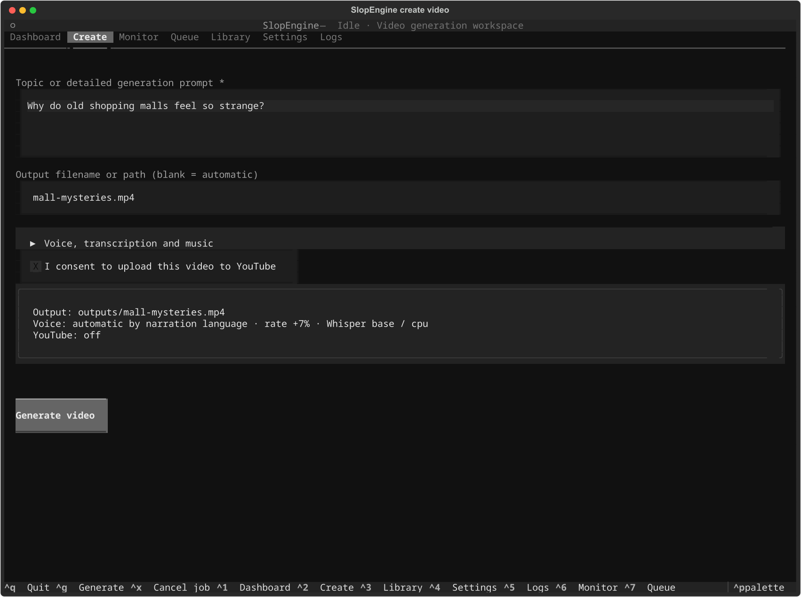
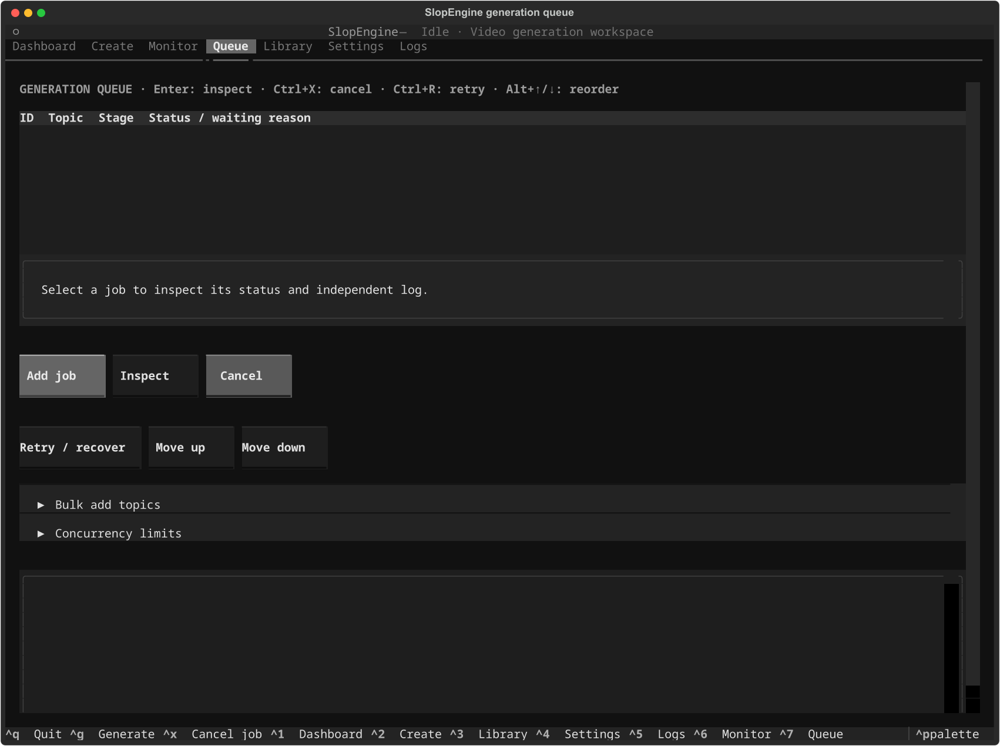

# SlopEngine

SlopEngine generates vertical short-form videos from a topic.

Launch the interactive workspace with `python -m slopengine`. The existing
`python shorts_core.py --topic "Example"` CLI remains available.

The pipeline asks Gemini for a rewritten YouTube title, spoken narration, Pexels search keywords, and a visual search query. It then uses Edge TTS for narration, Whisper for word-level captions, Pexels for portrait background video, and MoviePy to render a 9:16 MP4. It can also upload the finished video to YouTube Shorts.

## Screenshots





## Outputs

Generated files go under `outputs/` by default:

- `<timestamp>-<topic>.mp4`: rendered vertical video
- `<timestamp>-<topic>.metadata.json`: topic, generated title, script payload, word events, background files, output path, and YouTube upload metadata when present

Temporary media is created under `/tmp/shorts_core` by default and is cleaned after each run unless you pass `--keep-temp`.

## Requirements

- Python 3.11+; Python 3.12 is recommended for media dependency compatibility
- FFmpeg installed and available on `PATH`
- A Gemini API key
- A Pexels API key
- Optional: YouTube OAuth client secrets for upload

Install FFmpeg before generating videos. On Debian or Ubuntu, run `sudo apt install ffmpeg`; on macOS, run `brew install ffmpeg`. On Windows, install FFmpeg from the [official download page](https://ffmpeg.org/download.html) and add its `bin` directory to `PATH`. Confirm it is available with `ffmpeg -version`.

## Install

Clone the repository:

```bash
git clone https://github.com/Papajittan/SlopEngine.git
cd SlopEngine
```

Create and activate a virtual environment. On Linux or macOS:

```bash
python3.12 -m venv .venv
source .venv/bin/activate
```

On Windows PowerShell:

```powershell
py -3.12 -m venv .venv
.\.venv\Scripts\Activate.ps1
```

Install SlopEngine and its Python dependencies, then create your local config:

```bash
python -m pip install --upgrade pip
python -m pip install -e .
cp .env.example .env
```

In PowerShell, use `Copy-Item .env.example .env` for the last command. Edit `.env` and set `GEMINI_API_KEY` and `PEXELS_API_KEY` to your own keys. Keep `.env` private; it is ignored by git. The dashboard can open without credentials, but generating a video needs both keys, the media dependencies, and FFmpeg. The dashboard does not load Whisper, Torch, or MoviePy or call external providers. CPU Whisper is the default.

To run the legacy CLI without installing the package command, install dependencies with `python -m pip install -r requirements.txt` and run `python shorts_core.py ...` from the repository.

## Interactive workspace

The Textual interface has seven views:

| View | Features |
| --- | --- |
| Dashboard | Local dependency/key readiness, video count, latest output, active job |
| Create | Topic, optional filename, voice/transcription/music options, upload consent, summary |
| Monitor | Actual pipeline stages, elapsed time, live logs, cancellation, saved output or errors |
| Queue | Persistent jobs, bulk add, independent logs, retry/recovery, reordering, concurrency controls |
| Library | Existing MP4s, titles/topics, timestamps, sizes, upload status, metadata, open/copy path, topic reuse |
| Settings | Persistent non-secret engine, voice, output, music, caption, and upload privacy preferences |
| Logs | Live events and saved logs from previous generation jobs |

Use Tab / Shift+Tab to move focus, Enter to activate buttons, Space to toggle
checkboxes, and arrow keys to navigate tabs, tables and selections. Forms and
panels scroll in smaller terminals. Advanced Create options expand with Enter.

| Shortcut | Action |
| --- | --- |
| Ctrl+1 / Ctrl+2 / Ctrl+3 / Ctrl+4 / Ctrl+5 / Ctrl+6 / Ctrl+7 | Dashboard, Create, Library, Settings, Logs, Monitor, Queue |
| Ctrl+G | Generate using the Create form |
| Ctrl+X | Cancel the current generation |
| Ctrl+Q / Ctrl+C | Quit (asks before cancelling an active job) |

To generate: open Create, enter a topic or detailed prompt, optionally name the
MP4, expand advanced options if needed, review the summary, and choose Generate.
Plain filenames go into your configured output directory; paths with directories
are used as entered. Existing video or metadata files are never overwritten.
Leave the voice blank for automatic language selection, or enter an Edge TTS
voice such as `en-US-GuyNeural` to override it. The monitor follows Gemini,
Edge TTS, Whisper, Pexels, rendering, saving, and optional upload. It shows stage
states and elapsed time without inventing percentages. The persistent queue allows
up to two active jobs by default, while limiting concurrent renders to one and GPU
Whisper stages to one. Preparation can overlap a render; adjust these limits in
Queue. The app must remain open to advance queued work.

Upload is off for every new TUI session regardless of `YOUTUBE_UPLOAD_ENABLED`.
Check the explicit consent box for a job to upload; review privacy in the summary.
Privacy defaults to `private`. Existing CLI environment-driven upload behavior
is preserved. OAuth can open your browser during the upload stage. An upload
failure retains the finished local video and reports the error.

Open Library to inspect finished outputs or reuse a topic. Missing or malformed
metadata does not prevent listing a nonempty MP4. The system opener requires
`xdg-open` on Linux or `open` on macOS. Clipboard support depends on your terminal's
OSC 52 support; the full path is also displayed for manual copying.

### Preferences, execution and logs

Configuration precedence is environment / `.env` defaults, then saved application
preferences, then temporary Create options. Exported environment variables take
precedence over `.env`. CLI runs continue to use environment configuration only.
Settings are stored in `$XDG_STATE_HOME/slopengine/preferences.json`, defaulting to
`~/.local/state/slopengine/preferences.json`; job logs are in its `logs/` directory.
API keys are never saved in preferences. Key status shows presence only.
If the Gemini key is missing or still contains the `.env.example` placeholder,
Dashboard shows a masked input. Enter the key and press Enter or choose
**Use Gemini key** to configure it for the current session, including generation
workers. To keep it across restarts, configure `GEMINI_API_KEY` in `.env` or your
environment. Entered keys are not written to preferences or logs.

Generation runs in an isolated Python process, keeping Whisper and MoviePy off
the UI event loop and preserving the existing main-thread SIGALRM timeout.
Structured events and captured diagnostic output feed the monitor and saved JSONL
logs. Known environment secrets and credential fields are redacted.
Cancellation sends termination to the process group and escalates after four
seconds if required. Normal cancellation cleans temporary and staging files.
Forced termination, crashes, or power loss can leave hidden `.slopengine-*`
staging directories or temporary runs; these are not listed as completed videos.
`Keep temporary media` intentionally retains temporary diagnostics.
Never remove unrelated files when cleaning abandoned runs.

POSIX systems support process-group cancellation. Windows termination is more
limited: descendant process cleanup and SIGALRM timeouts are not guaranteed there.
Generation and the existing external-service integrations should be exercised in
your own environment before relying on unattended runs.

For Whisper CUDA, avoid Python 3.14. Use a Python 3.12 environment and keep
`WHISPER_DEVICE=cuda` in `.env`:

```bash
python3.12 -m venv .venv312
.venv312/bin/python -m pip install --upgrade pip
.venv312/bin/python -m pip install torch torchvision torchaudio --index-url https://download.pytorch.org/whl/cu130
.venv312/bin/python -m pip install -r requirements.txt
.venv312/bin/python shorts_core.py --upload
```

If your GPU driver needs a different CUDA wheel, choose the matching pip command
from the PyTorch install selector.

If Whisper or MoviePy cannot read media, check FFmpeg first:

```bash
ffmpeg -version
```

## Configuration

Copy the example env file and fill in your own keys:

```bash
cp .env.example .env
```

Do not commit real credentials. `.env`, `client_secrets.json`, and `.youtube_token.json` are ignored by git.

Required keys:

| Variable | Purpose |
| --- | --- |
| `GEMINI_API_KEY` | Google AI Studio key for script, title, keywords, and Pexels query generation |
| `PEXELS_API_KEY` | Pexels API key for background videos |

Common optional keys:

| Variable | Default | Purpose |
| --- | --- | --- |
| `GEMINI_MODEL` | `gemini-2.5-flash` | Gemini model for content generation |
| `GEMINI_TIMEOUT_SECONDS` | `60` | Gemini content generation timeout |
| `EDGE_TTS_VOICE` | `en-US-AriaNeural` | Edge TTS voice |
| `EDGE_TTS_RATE` | `+7%` | Speech rate |
| `EDGE_TTS_PITCH` | `-3Hz` | Speech pitch |
| `EDGE_TTS_VOLUME` | `+0%` | Speech volume |
| `WHISPER_MODEL` | `base` | Whisper model name |
| `WHISPER_DEVICE` | `cpu` | Whisper device. Keep `cpu` on Python 3.14 to avoid CUDA/Triton word-timestamp failures |
| `SHORTS_OUTPUT_DIR` | `outputs` | Rendered video and metadata directory |
| `SHORTS_TEMP_ROOT` | `/tmp/shorts_core` | Temporary media directory |
| `CAPTION_FONT_PATH` | auto-detected | Path to a scalable `.ttf` or `.otf` font |
| `CAPTION_FONT_SIZE` | `220` | Caption font size |
| `BACKGROUND_MUSIC_PATH` | blank | Optional local music file |
| `BACKGROUND_MUSIC_VOLUME` | `0.12` | Music volume multiplier |

YouTube upload keys:

| Variable | Default | Purpose |
| --- | --- | --- |
| `YOUTUBE_UPLOAD_ENABLED` | `false` | Upload after rendering when true |
| `YOUTUBE_CLIENT_SECRETS_FILE` | `client_secrets.json` | OAuth client secrets file |
| `YOUTUBE_TOKEN_FILE` | `.youtube_token.json` | Stored OAuth token |
| `YOUTUBE_PRIVACY_STATUS` | `private` | `private`, `unlisted`, or `public` |
| `YOUTUBE_CATEGORY_ID` | `22` | YouTube category ID |

## Usage

Generate a video:

```bash
python3 shorts_core.py --topic "Why your 8-hour workday is failing"
```

Choose an output file:

```bash
python3 shorts_core.py --topic "The hidden cost of context switching" --output outputs/context-switching.mp4
```

Keep temporary media for debugging:

```bash
python3 shorts_core.py --topic "How cities became louder" --keep-temp
```

Use background music for one run:

```bash
python3 shorts_core.py --topic "Why old malls feel strange" --music ost.mp3 --music-volume 0.12
```

Upload after rendering:

```bash
python3 shorts_core.py --topic "Why your 8-hour workday is failing" --upload
```

If you omit `--topic`, the script prompts for a topic and optional output file.

## Generated Titles

The YouTube title is not the raw topic. Gemini rewrites the topic into a shorter, more engaging title and stores it in `script_payload.title` inside the metadata file. Upload uses that generated title when metadata is present.

Example:

```text
Topic: The '8-hour workday' is actually a scam designed for the 1800s, and it is destroying your productivity.
Generated title: Why Your 8-Hour Workday Is Failing
```

If a generated title is missing, SlopEngine falls back to the normalized topic and caps it at YouTube's 100-character limit without adding ellipses.

## YouTube Upload

To upload, create an OAuth desktop client in Google Cloud and save the downloaded secrets JSON as `client_secrets.json`, or point `YOUTUBE_CLIENT_SECRETS_FILE` at the file.

On the first upload, the script opens a local OAuth flow and writes `.youtube_token.json`. Later uploads reuse that token when possible.

If Google rejects a saved refresh token with `invalid_grant`, the uploader opens
the browser sign-in flow again and saves the replacement credentials after sign-in
succeeds. Other refresh failures are left for retry. External OAuth apps in
[Testing status](https://developers.google.com/identity/protocols/oauth2/#expiration)
issue refresh tokens that expire after seven days for YouTube upload scopes.

Upload metadata is merged into the rendered video's `.metadata.json` file:

```json
{
  "youtube": {
    "video_id": "example-id",
    "url": "https://www.youtube.com/watch?v=example-id"
  }
}
```

## Project Layout

| Path | Purpose |
| --- | --- |
| `shorts_core.py` | Main pipeline, CLI, rendering, and upload code |
| `requirements.txt` | Python dependencies |
| `.env.example` | Safe config template |
| `tests/` | Unit tests |
| `outputs/` | Rendered videos and metadata |

## Verification

Run the project checks after Python changes:

```bash
python3 -m unittest discover
python3 -m py_compile shorts_core.py
python3 -m compileall -q slopengine tests
```

The suite includes Textual Pilot keyboard/form workflows, mocked pipeline stages,
worker completion/failure, real process cancellation, settings, library handling,
and the existing CLI tests. It requires no provider credentials or rendering.

For caption or visual changes, render a short sample and inspect at least one frame or preview video.

## Troubleshooting

- `No module named textual`: install requirements in the same Python environment used to launch `python -m slopengine`.
- Failed worker or missing engine: inspect Monitor or Logs, install `requirements.txt`, and check FFmpeg. A failed generation leaves the application usable.
- Invalid configuration: check the Settings validation message and numeric values in `.env`. Changing credentials in `.env` takes effect after restarting the app; exported environment variables take precedence.
- Whisper device failures: choose `cpu` in Create or Settings. CUDA availability is checked by the actual engine in the worker; the dashboard never loads Torch to probe the GPU.
- An upload failure leaves the completed video in Library. Check OAuth client configuration, browser access, and privacy settings before trying another explicitly consented upload.
- Edge TTS `WSServerHandshakeError: 403`: versions through `7.2.8` use an outdated service handshake. Upgrade in the same environment that runs the script: `rtk proxy .venv312/bin/python -m pip install --upgrade 'edge-tts>=7.3.1'` (replace the interpreter path if you use a different environment).
- `GEMINI_API_KEY is required` or `PEXELS_API_KEY is required`: set the missing key in `.env`.
- `Gemini generate_content exceeded ... seconds`: increase `GEMINI_TIMEOUT_SECONDS` in `.env` or retry later if Gemini is slow.
- Gemini high-demand warning: the script retries with another available generateContent model when possible.
- YouTube dependency error: install the packages in `requirements.txt`; upload needs `google-api-python-client`, `google-auth-oauthlib`, and `google-auth-httplib2`.
- Whisper CUDA or Triton timestamp errors on Python 3.14: use the Python 3.12 CUDA setup above, or set `WHISPER_DEVICE=cpu`.
- Captions render with the wrong font: set `CAPTION_FONT_PATH` to a real scalable font file.

## Persistent generation queue

The TUI Queue tab (Ctrl+7) accepts individual and bulk jobs while generation is
running. Queue state survives restarts, and interrupted or restored jobs require
explicit recovery; they do not resume automatically. Independent workers, logs,
outputs, stage admission and RAM reservations isolate jobs. The app must stay open
to advance queued work.



See [concurrent generation](docs/concurrent-generation.md) for controls, memory
configuration, recovery and limitations, and the opt-in
[paired rendering benchmark](docs/paired-render-benchmark.md). Two simultaneous
production renders remain unverified; keep the default render limit of one.
